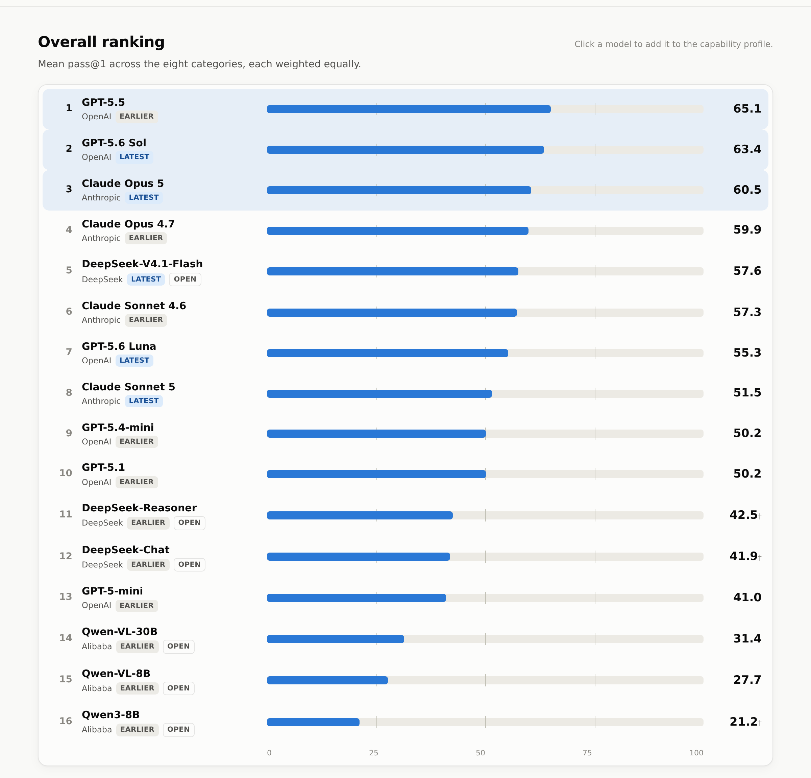

# PDAGENT-BENCH Leaderboard

**PDAGENT-BENCH** measures how well large language models handle VLSI **physical design** (backend) work. It has 343 tasks in eight categories: foundational knowledge, root-cause analysis and tool-report reading, through to writing exact ICC2, Innovus, Formality and PrimeTime ECO commands.

**Interactive leaderboard: https://fenggev56.github.io/PDAGENT-BENCH/**

[](https://fenggev56.github.io/PDAGENT-BENCH/)

## Leaderboard (pass@1, %)

Overall is the unweighted mean of the category scores. † = text-only model, averaged over the 6 categories that need no image input.

<!-- LEADERBOARD:START -->
| # | Model | Round | Overall | Foundational | Root-Cause | Report | STA | FM | ECO | ICC2 | Innovus |
|---|---|---|---|---|---|---|---|---|---|---|---|
| 1 | GPT-5.5 | R1 | **65.1** | 80.4 | 73.3 | 74.6 | 72.7 | 81.8 | 50.0 | 45.5 | 42.2 |
| 2 | GPT-5.6 Sol | R2 | **63.4** | 85.7 | 65.7 | 68.2 | 72.7 | 81.8 | 40.0 | 52.3 | 41.1 |
| 3 | Claude Opus 5 | R2 | **60.5** | 90.0 | 74.8 | 53.6 | 63.6 | 81.8 | 40.0 | 39.8 | 40.0 |
| 4 | Claude Opus 4.7 | R1 | **59.9** | 82.4 | 76.2 | 64.1 | 72.7 | 72.7 | 40.0 | 34.1 | 36.7 |
| 5 | DeepSeek-V4.1-Flash | R2 | **57.6** | 84.8 | 66.9 | 50.4 | 72.7 | 77.3 | 40.0 | 36.4 | 32.2 |
| 6 | Claude Sonnet 4.6 | R1 | **57.3** | 82.6 | 68.8 | 66.8 | 63.6 | 63.6 | 50.0 | 34.1 | 28.9 |
| 7 | GPT-5.6 Luna | R2 | **55.3** | 84.8 | 57.6 | 60.0 | 45.5 | 59.1 | 60.0 | 38.6 | 36.7 |
| 8 | Claude Sonnet 5 | R2 | **51.5** | 82.9 | 57.4 | 62.3 | 54.5 | 54.5 | 40.0 | 27.3 | 33.3 |
| 9 | GPT-5.4-mini | R1 | **50.2** | 72.3 | 54.5 | 46.1 | 63.6 | 59.1 | 50.0 | 29.5 | 26.7 |
| 10 | GPT-5.1 | R1 | **50.2** | 82.0 | 65.5 | 65.5 | 54.5 | 54.5 | 20.0 | 31.8 | 27.8 |
| 11 | DeepSeek-Reasoner | R1 | **42.5**† | 73.7 | 61.2 | N/A | N/A | 45.5 | 30.0 | 21.6 | 23.3 |
| 12 | DeepSeek-Chat | R1 | **41.9**† | 72.6 | 48.6 | N/A | N/A | 40.9 | 30.0 | 34.0 | 25.6 |
| 13 | GPT-5-mini | R1 | **41.0** | 80.0 | 56.0 | 65.5 | 54.5 | 22.7 | 30.0 | 5.7 | 13.3 |
| 14 | Qwen-VL-30B | R1 | **31.4** | 69.2 | 37.9 | 32.3 | 54.5 | 27.3 | 10.0 | 9.1 | 11.1 |
| 15 | Qwen-VL-8B | R1 | **27.7** | 53.3 | 24.5 | 32.7 | 54.5 | 27.3 | 10.0 | 6.8 | 12.2 |
| 16 | Qwen3-8B | R1 | **21.2**† | 54.3 | 25.5 | N/A | N/A | 27.3 | 0.0 | 8.0 | 12.2 |
<!-- LEADERBOARD:END -->

**R2** = latest evaluation (2026-09-23). **R1** = earlier evaluation reported in the paper. Rule-checked categories (STA, FM, ECO, ICC2, Innovus) use identical checkers in both rounds. The three judged categories (Foundational, Root-Cause, Report) were scored by different judges in the two rounds, so compare those columns within a round only.

## Categories

| Category | Group | Tasks | Grading | What it tests |
|---|---|---|---|---|
| Foundational Knowledge | Understanding | 90 | LLM judge (0–10 rubric) | Floorplanning, CTS, STA, DFT, extraction, device physics, flow inputs/outputs |
| Root-Cause Analysis | Understanding | 21 | LLM judge (0–10 rubric) | Diagnosing real backend failures (hold, IR drop, congestion, SDC, multi-voltage) and proposing fixes |
| Report Comprehension | Understanding | 11 | LLM judge (0–10 rubric) | Reading Innovus / PrimeTime reports and screenshots (multimodal) |
| Static Timing Analysis | Understanding | 11 | Rule checker | Timing calculations and multiple-choice STA, some from circuit diagrams (multimodal) |
| Formal Verification | Script Generation | 22 | Rule checker | Exact Formality commands |
| ECO | Script Generation | 10 | Rule checker | PrimeTime ECO commands |
| P&R Script (ICC2) | Script Generation | 88 | Rule checker | Exact IC Compiler II Tcl across the full P&R flow |
| P&R Script (Innovus) | Script Generation | 90 | Rule checker | Exact Innovus Tcl across the full P&R flow |

## Protocol

- Plain base-model API calls: no tools, retrieval or agent loop, and one stateless turn per task.
- **pass@1**: one sample. **pass@5**: five separate samples. For rule-checked tasks a task counts as passed if any sample is correct; for judged tasks the score is the mean over the 5 samples.
- Latest round (R2): reasoning effort *medium*, no temperature, 32K output-token cap, and a blind GPT-5.4-mini judge (model identity scrubbed, jobs shuffled across candidates).
- STA, ECO and Report have only 10–11 tasks, so one task moves the score by about 9–10 points.

## Repository layout

```
index.html                 the leaderboard site (static, served by GitHub Pages)
data/leaderboard.json      all scores (pass@1 / pass@5 per model per category)
data/leaderboard.js        same data, loaded by index.html
data/round1_earlier.csv    earlier-round scores, as reported in the paper
scripts/build_data.py      rebuilds data/ and the table above from evaluation outputs
```

## Adding a model

1. Run the evaluation harness for the new model. It writes `results/<subset>/<model>/summary.json`.
2. Add the model to `LATER_MODELS` in `scripts/build_data.py`.
3. Run `python3 scripts/build_data.py --later-eval /path/to/eval`. This regenerates `data/` and the README table.
4. Commit and push. GitHub Pages redeploys automatically.

## Citation

```bibtex
@misc{pdagentbench2026,
  title  = {PDAGENT-BENCH: Benchmarking LLM Agents for VLSI Physical Design},
  year   = {2026},
  url    = {https://github.com/fenggev56/PDAGENT-BENCH}
}
```
